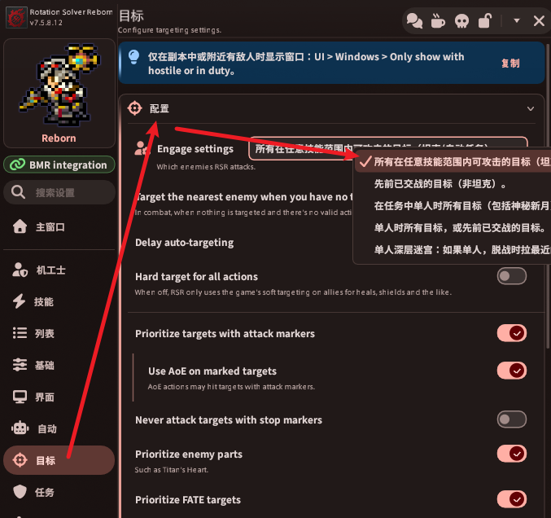
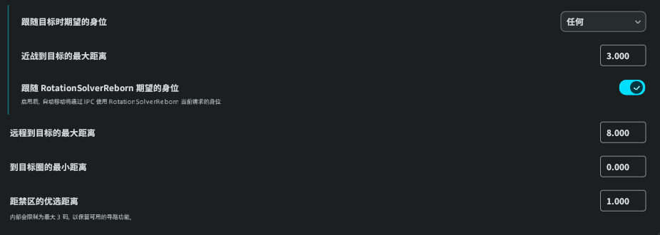

# MerchantAssist 新手教程

MerchantAssist 用于双人游玩「深读商客奇谭」。队长和队员都需要完成下方配置。第一次运行请旁观一轮，确认进本、战斗及结算都能正常衔接。

## 安装和准备

1. 在国服卫月（Dalamud）中安装 MerchantAssist。两端使用同一版本。如已安装独立版 MerchantTrump，先停用它。
2. 安装自动循环插件并开启**主动攻击**。下方以 Rotation Solver Reborn（RSR）为例。
3. 安装 **BossMod Reborn（BMR）** 和 **vnavmesh**。下表是本教程使用的订阅源。

| 插件 | 仓库地址 |
| --- | --- |
| MerchantAssist | `https://raw.githubusercontent.com/Angelways/DalamudPlugins/main/pluginmaster.json` |
| BossMod Reborn（逆光喵版） | `https://raw.githubusercontent.com/NiGuangOwO/DalamudPlugins/main/pluginmaster.json` |
| vnavmesh（国际服原版） | `https://puni.sh/api/repository/veyn` |

### 检查可能冲突的设置

- 关闭 TextAdvance、YesAlready、Daily Routines、OmniToolBox 等插件里会跳过对话或自动点击确认框的功能。
- 关闭其他插件中会与 MerchantAssist 冲突的功能，例如原地复活。
- 如果客户端设置了帧数上限，请设为 **45 FPS 或更高**。关闭客户端和其他插件里的所有**后台帧数限制**。帧数过低可能影响机制处理。

## 配置 RSR 和 BMR

### Rotation Solver Reborn

在 RSR 打开「目标 → 配置」，按图设置 **Engage settings**，并确认已开启主动攻击。

### BossMod Reborn

**必开选项。**打开「战斗时跟随」「Boss 模块激活时跟随」和「跟随目标」。

**参考配置。**位置选「任何」，近战最大距离设为 3，远程最大距离设为 8，目标圈最小距离设为 0，禁区优选距离设为 1。使用 RSR 时，可按图开启「跟随 RotationSolverReborn 期望的身位」。

## 自动精制和自动修理

有需要时，可以使用 Daily Routines（DR）的自动修理和自动精制。MerchantAssist 已对常见的修理和精制流程做了适配。

如果想减少流程中断，可以关闭自动精制，在 DR 自动修理中开启「允许委托非玩家角色修理」和「优先委托非玩家角色修理」，然后在维修 NPC 附近启动 MerchantAssist。

## 首次打开和双人启动

1. 双方登录游戏，输入 `/massist`。如果插件要求绑定，按提示输入管理员发给当前角色的一次性绑定码。
2. 点击「打开 MerchantTrump」。如果出现首次使用提示，点击「打开新手教程」阅读本页，返回游戏后填写下方的教程密码。

   **教程密码：`1605`**

3. 密码正确后，用鼠标连续按住「长按确认 3 秒」，直到按钮上的进度条走完、弹窗关闭。
4. 组成两人小队，在特殊迷宫探索器设置所需的多变技能。双方在插件「流程」页选择与实际队伍身份一致的模式，并检查循环次数和战利品选项。
5. **队员先点「开始」，队长随后点「开始」。**需要回看教程时，可点击主页面的「打开新手教程」。

## 实验性玩法

「摔炮」是可选的实验性打法。可让一位玩家选择开场无资源要求且爆发高的职业，例如龙骑士，不带治疗技能，只带挑衅和精神标。角色死亡后依靠插件的原地复活，再次打出 120 秒循环中的高威力技能。首次使用建议先用常规配置跑通流程，再单独尝试。
