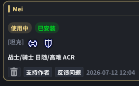
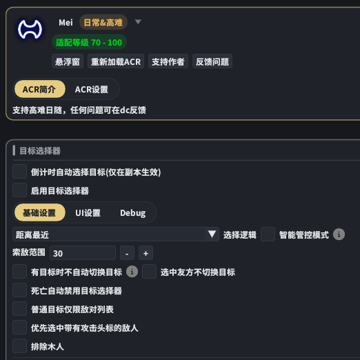
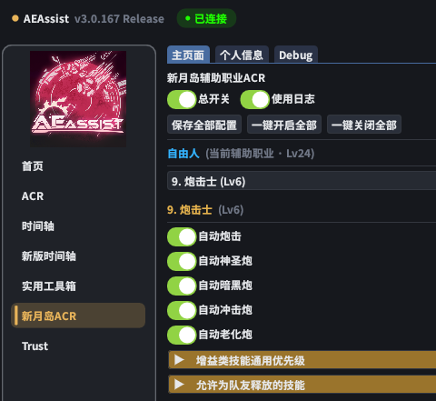
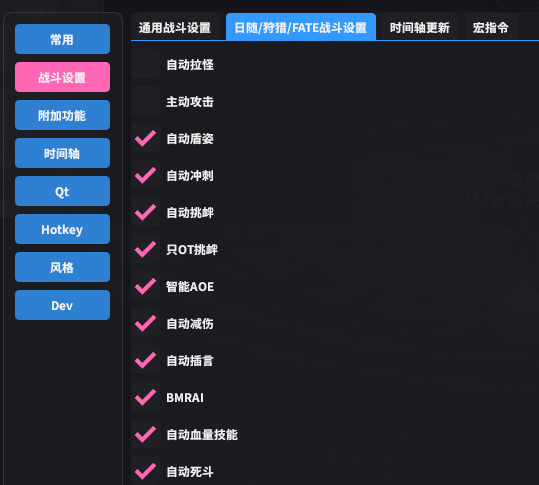
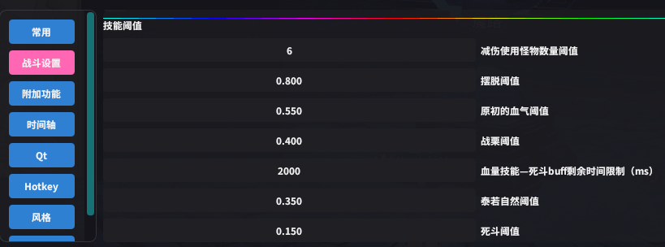
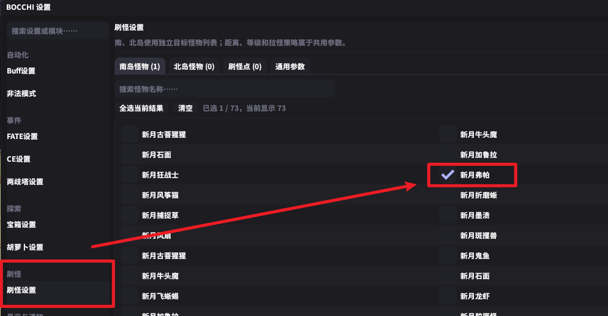
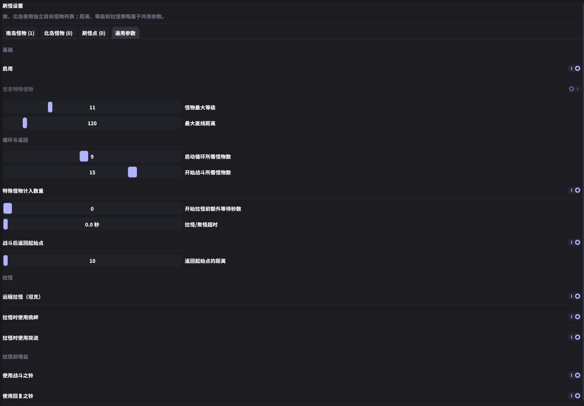
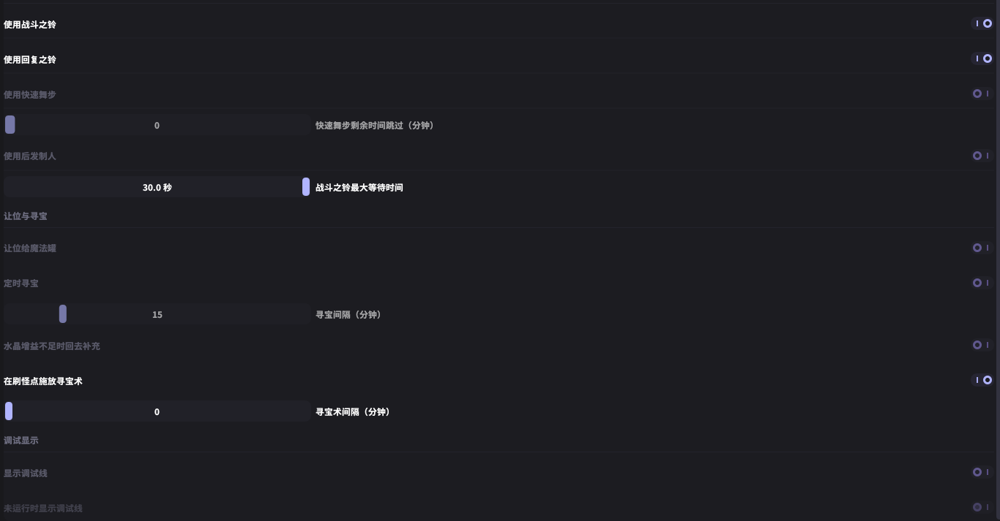

# OCNFarmer刷怪模式教程

刷怪模式由 OCNFarmer 负责进本、移动、购买与满箱后的寻宝流程，由 BOCCHI 负责拉怪和魔寻宝，输出插件负责战斗。请先完成下列配置，再在 OCNFarmer 中选择“刷怪模式”并点击开始。

> 刷怪模式下，获取宝箱的速度可能有所提升，但副本中野怪属于排他性资源，使用时请自行承担相关风险。使用前必须阅读并检查插件中的设置与本教程。

## 一、启用前的必要准备

### 1. 确认插件和辅助职业可用

- **OCNFarmer**：使用包含刷怪模式及其专属设置的版本，先完成插件验证。
- **BOCCHI**：使用支持刷怪功能的 **Kano 版本**，确认能够使用 `/bocchimobfarmer on` 和 `/bocchimobfarmer off`。
- **Daily Routines（DR）**：启用“蜃景幻界新月岛 助手”“更好的辅助职业列表”“辅助职业切换指令”“自动任务出发确认”“特殊场景探索进入指令”。主界面的一键开启按钮可用于开启这些模块。
- **导航插件**：准备可用的 vnavmesh，并等待当前区域导航网格加载完成。
- **输出插件**：自行配置输出、回复与减伤。刷怪模式下，OCNFarmer **不会启用或关闭 RSR**，主界面的“RSR 支持”开关在此模式中不生效。
- **辅助职业**：提前解锁准备使用的辅助职业，默认是“辅助炮击士”。

BOCCHI Kano 版本仓库地址：

```text
https://raw.githubusercontent.com/KanoNoUta/DalamudPlugins/main/pluginmaster.json
```

### 2. 配置输出插件

刷怪需要足够的补正、回复和战斗能力。以下是作者提供的实测参考配置，供对照使用；其他职业、补正或 ACR 的表现需要自行测试。

| 项目 | 参考配置 |
| --- | --- |
| 战斗职业 | 战士 |
| 辅助战斗职业 | 辅助炮击士 |
| 补正 | 装备共 10 补正，另有 12 星辅助职业大师 |
| 输出插件 | AEAssist |
| 输出 ACR | Mei |

首次使用时，建议观察至少一轮拉怪、战斗、回复与寻宝衔接，确认角色能够持续存活、正常输出，再继续运行。

#### Mei 与目标选择

使用 Mei ACR，并参照图示检查目标选择器和相关开关。





#### 新月岛辅助职业 ACR

在 AEAssist 的“新月岛 ACR”中，开启总开关，并检查炮击士相关技能设置。下面截图展示了原稿使用的自动炮击、神圣炮、暗黑炮、冲击炮和老化炮配置。



#### 战斗模式、回复与减伤

使用 Mei 的“日随模式”。参照下图检查自动盾姿、冲刺、挑衅、智能 AOE、减伤、回血技能及其阈值，保证被拉来的怪物能够被接住并持续处理。






截图中的阈值属于参考配置。若自己的补正、辅助职业或战斗能力不同，请根据实际承伤与回复情况调整。

## 二、配置 BOCCHI 刷怪模式

### 1. 选择目标怪物

打开 BOCCHI 设置中的“刷怪设置”，在“南岛怪物”页选择 **新月弗帕**，并核对是否误选了其他怪物。



### 2. 配置通用参数

切换到“通用参数”，先按截图配置，再根据自己的战斗能力调整。

| 项目 | 原稿参考值 |
| --- | --- |
| 怪物最大等级 | `11` |
| 最大直线距离 | `120` |
| 启动循环所需怪物数 | `9` |
| 开始战斗所需怪物数 | `15` |
| 开始拉怪前额外等待秒数 | `0` |
| 拉怪／聚怪超时 | `0.0 秒` |
| 返回起始点的距离 | `10` |

远程拉怪、挑衅、突进、战斗之铃、回复之铃等开关请按图核对。数值与开关应结合当前 BOCCHI 版本的说明使用，不同版本的界面可能有所变化。



### 3. 开启刷怪点魔寻宝

**必须开启“在刷怪点施放寻宝术”。** 请同时核对图中其他寻宝、补充与返回选项。

刷怪过程中由 BOCCHI 释放魔寻宝，OCNFarmer 读取魔寻宝的系统结果来更新宝箱数量、检测货币并执行安全检查。若 BOCCHI 未释放魔寻宝，后续检查也不会按预期触发。

> 主界面通用说明中关于关闭 BOCCHI 自动魔寻宝的提示，不能替代本节的刷怪模式配置。刷怪模式需要开启这里的“在刷怪点施放寻宝术”；截图中的独立“定时寻宝”保持关闭，避免额外流程互相干扰。



## 三、配置 OCNFarmer 专属设置

在“自动化模式选择”中找到“刷怪模式”，点击其后的“设置”。

### 1. 刷怪辅助职业

刷怪模式下辅助职业的选择独立于插件通用设置，默认“辅助炮击士”。每次到达刷怪起点后，插件会先下坐骑，再切换并确认所选辅助职业，确认成功后才启动 BOCCHI 刷怪。

若一直显示“等待辅助职业切换”，请检查辅助职业是否已解锁、DR 辅助职业切换指令模块是否已启用，以及角色是否处于可切换状态。

### 2. 安全功能检测设置

| 模式 | 触发条件 |
| --- | --- |
| 标准模式 | 周围 50 米内存在任意其他玩家 |
| 黑名单模式 | 周围 50 米内存在名单中 CID 匹配的玩家 |

检测排除自己，距离包含高度差；

黑名单模式下，选中其他玩家后点击“添加选中的玩家与 CID”，即可保存名单。列表显示“玩家名@所属区服”和 CID，可逐项移除；实际匹配使用 CID，玩家改名后仍可识别。同名但 CID 不同的玩家不会仅因姓名相同而命中。

**黑名单为空时，不会因附近玩家触发黑名单安全行为。**

### 3. 安全功能行为设置

可选择以下一种行为：

1. **退出副本并停止插件**：先停止 BOCCHI 刷怪，退出副本后停止流程。
2. **退出副本后切换自动化模式**：指定“南征之章”或“北征之章”，先退出当前副本，再启动对应流程。
3. **等待玩家离开，等待超时后退出副本切换模式**：检测到指定玩家后，先等待特定时间，如果玩家离开则继续刷怪；如果等待超过特定时长则先退出当前副本，再启动选择的对应流程。

默认配置为“标准模式＋退出副本并停止插件”。若同一次检查同时满足安全条件、购买条件和满箱条件，优先执行安全行为。运行期间可查看设置与管理黑名单；修改辅助职业、安全模式和触发行为前，需要先停止运行。

### 4. 自动购买

刷怪模式沿用**自动购买**设置。需要购买时，请提前设置商品、数量、优先级和银币／金币触发阈值。

达到购买条件后，插件会停刷、返回营地并前往大水晶购买。购买结束后，重新传送到水晶洞窟、前往刷怪点，并再次完成下坐骑和辅助职业确认后继续刷怪。若购买条件与满箱条件同时满足，会先购买，再执行寻宝。

## 四、常见问题

### 拉怪过程中出现卡顿

请使用原版 vnav 导航插件。请检查当前导航版本、网格是否加载完成，并排除多个导航流程同时控制角色的情况。

原版导航插件仓库地址：

```text
https://puni.sh/api/repository/veyn
```

### 到达刷怪点后没有开始刷怪

先查看插件状态：是否仍在下坐骑或等待辅助职业切换。检查指定职业是否已解锁、DR 模块是否可用，以及 BOCCHI 是否为支持刷怪指令的 Kano 版本。插件不会仅因导航结束或发出切换命令就直接开刷。

### 宝箱数量、自动购买或安全检查没有更新

确认 BOCCHI 的“在刷怪点施放寻宝术”已开启，并确认游戏实际出现了魔寻宝的宝箱数量系统提示。OCNFarmer 依赖该系统结果触发本轮检查；仅开启输出或杀怪不会触发这些检查。

### RSR 没有自动开启

刷怪模式不会控制 RSR。请自行准备并启用合适的输出方案。若安全行为切换到了普通南征／北征流程，后续则按普通模式的 RSR 设置运行。

### 自动购买没有触发

检查南岛自动购买是否启用了商品、货币阈值与数量是否合理，以及魔寻宝系统结果是否正常出现。购买失败后存在短暂冷却，不会立即反复尝试。

### 战斗中频繁倒地或无法清怪

先停止流程，检查补正、回复、减伤、目标选择和实际拉怪数量。本文中的战士、炮击士与 Mei 配置是作者的实测参考，不能保证其他配置取得同样效果。

## 五、反馈建议

如果有更合适的刷怪地点，南岛和北岛都欢迎提出建议。反馈时请附上区域、坐标、目标怪物、职业、辅助职业、补正及实际运行表现，方便判断是否适合新增路线。
